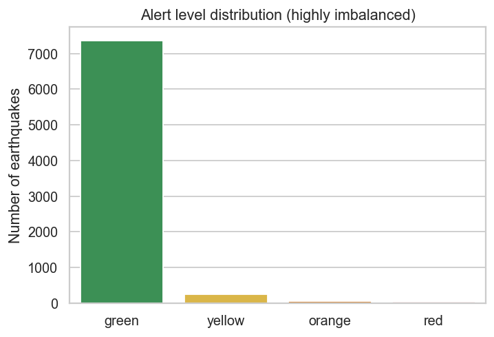
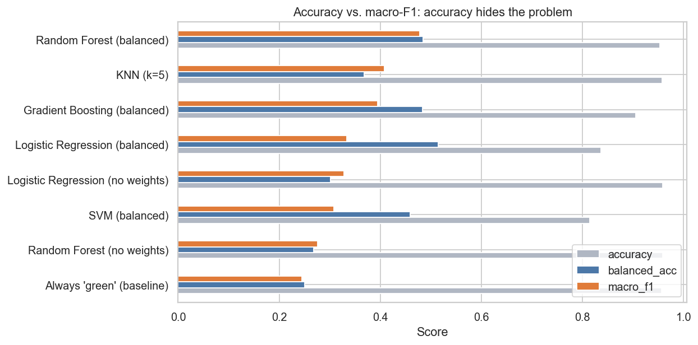
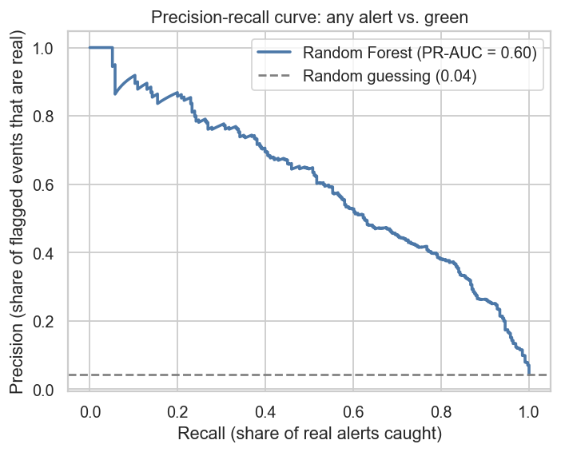

# Earthquake Alert Prediction

Predicting the alert level (`green`, `yellow`, `orange`, `red`) of large earthquakes (M4.5+) from magnitude, depth, location and region, with a small Flask app to try the model.

**Main lesson of this project:** about 96% of the events are `green`, so "96% accuracy" means nothing here. Always answering "green" scores the same. This project evaluates the models properly (macro-F1, per-class recall, PR-AUC, a time-based test) and handles the class imbalance.



## Dataset
- 7,699 earthquakes (1976–2024) with magnitude, depth, coordinates, place name and an alert level. Column format follows the USGS earthquake catalog.
- Provided during my internship at MITU Skillologies (`mitu.co.in/dataset`). 18 non-earthquake rows (volcanic eruptions, one nuclear explosion) were removed.
- Class counts: green 7,368 · yellow 246 · orange 52 · red 33.

## Tools
Python, pandas, NumPy, scikit-learn, matplotlib, seaborn, Flask, Jupyter

## Approach
1. **Cleaning:** kept all large-magnitude events (no outlier deletion), fixed timestamp parsing, removed non-earthquake events.
2. **Feature engineering:** `region` extracted from the place name (rare regions grouped as `Other`) as a proxy for population and building vulnerability.
3. **EDA:** alert rate by magnitude, depth and region; global map; events per year.
4. **Models compared** with stratified 5-fold cross-validation: Logistic Regression, KNN, SVM, Random Forest, Gradient Boosting, each against an "always green" baseline. Class weights used to handle imbalance.
5. **Tuning:** `RandomizedSearchCV` (macro-F1) on events up to 2019, tested on 2020–2024.
6. **Deployment:** a single scikit-learn pipeline saved with joblib and served by Flask.

## Results
Cross-validated (each event predicted by a model that never saw it):

| Model | Accuracy | Macro-F1 |
|---|---|---|
| Always "green" | 95.7% | 0.24 |
| Logistic Regression (no class weights) | 95.9% | 0.33 |
| Random Forest (no class weights) | 95.9% | 0.28 |
| Random Forest (balanced) | 95.3% | 0.48 |
| **Final: tuned balanced Random Forest** | 93.3% | 0.46 |

Final model, recall per class: yellow **52%**, orange **17%**, red **39%** (unweighted Random Forest: 7%, 0%, 0%). Accuracy drops slightly because the model now raises alerts instead of always saying "green". That is the right trade-off for an alert system.



**As an "any alert" detector** (P(alert) = 1 − P(green)): PR-AUC **0.60** vs 0.04 for random guessing. At a 0.20 threshold it catches 93% of real alerts and flags 19% of events (precision 21%); at 0.50 it catches 80% with 38% precision. The threshold is a business decision.



**Time-based check** (train ≤2019, test 2020–2024): macro-F1 0.42, alert PR-AUC 0.53. Lower than cross-validation, so expect somewhat worse results on future events.

**Honest notes**
- The `region` feature helps only a little (PR-AUC 0.61 → 0.64); most of the gain comes from handling the imbalance.
- Hyperparameter tuning made no meaningful difference (default settings: macro-F1 0.41 on the time-based test).
- Orange and red have only 52 and 33 examples, so their per-class numbers are noisy.
- The alert level seems to depend on population exposure and building vulnerability, which are not in the data. That limits what location, depth and magnitude can predict.

## Project history
My first version (built during my internship) reported 96.2% accuracy with Random Forest. Looking back, that equalled the majority-class baseline: the model caught almost none of the orange/red events. This version fixes the evaluation, the imbalance handling, and several bugs (empty date features, silently skipped encoding, outlier removal deleting the large earthquakes, leakage from scaling before the split, a comparison table with identical numbers for every model).

## Project structure
```
├── data/earthquakes.csv
├── notebooks/Earthquake_Alert_Prediction.ipynb   # full analysis
├── src/train_model.py                            # retrain the final model
├── models/alert_model.joblib                     # saved pipeline
├── app/app.py, app/templates/index.html         # Flask app
├── images/                                       # charts used above
└── requirements.txt
```

## How to run
```bash
pip install -r requirements.txt

# explore the analysis
jupyter notebook notebooks/Earthquake_Alert_Prediction.ipynb

# (optional) retrain and re-save the model, e.g. after a scikit-learn version warning
python src/train_model.py

# start the app, then open http://127.0.0.1:5000
python app/app.py
```

API example:
```bash
curl -X POST http://127.0.0.1:5000/predict -H "Content-Type: application/json" \
  -d '{"latitude": 35.7, "longitude": 139.7, "depth": 10, "mag": 7.1, "region": "Japan"}'
```
Returns the predicted alert, the probability of each class, and the probability of any alert.

## Limitations and next steps
Add population-density and distance-to-coast data, try probability calibration, merge orange and red into one "high" class, and monitor performance as new events arrive. This is a learning project, not a real early-warning system.

## Author
Darshani Mutyal · [LinkedIn](https://www.linkedin.com/in/darshani-mutyal-kth/) · darshanimutyal01@gmail.com
